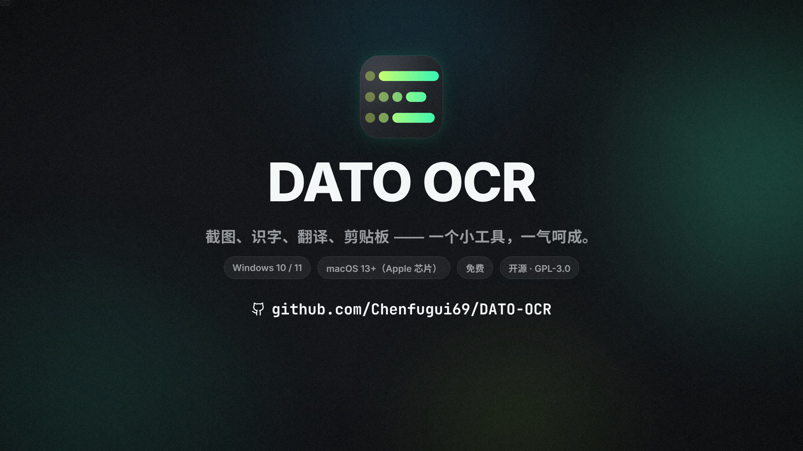

# DATO OCR 宣传片

<p align="center"></p>

- 中文版：[dato-ocr-promo.mp4](dato-ocr-promo.mp4)
- 英文版：[dato-ocr-promo-en.mp4](dato-ocr-promo-en.mp4)

1920×1080 · 60 fps · 78 秒 · 立体声。画面、配乐、音效全部由这个目录里的代码生成，没有用任何素材、采样或剪辑软件。

## 讲了个什么故事

一句话贯穿全片：**Simplicity is the ultimate sophistication.**

开场它是一张图里的像素，看得见、选不中；中间它被截下来、认出来、原位翻译、划词翻译、进了剪贴板；结尾片子自己按下 F1，把 GitHub 地址框起来识字复制 —— 观众看到的最后一个动作，就是这个工具本身。

图标的寓意是"左边散开的点是像素，往右连成线 = 认出来的字"，片子里所有转场都从这个图形长出来：开场的点阵、识字时点 → 光条 → 文字、品牌转场里横扫全屏的三条线、隐私一节用点拼成的锁。

| 时间 | 段落 | 画面 |
|---|---|---|
| 0:00 | 看得见，拿不走 | 一个点涌出整句名言（像素点阵），光标去拖选，选不中 |
| 0:08 | 四步、四个工具 | 截图工具 → 在线识字 → 翻译网页 → 笔记，弹窗越堆越乱，全部被吸进一个点 |
| 0:14 | 落拍 | 点炸开长成图标，"截图 · 识字 · 翻译 · 剪贴板" |
| 0:20 | 01 截图 | 自动识别窗口、拖选、画框、箭头、马赛克、复制；长截图 / GIF / 贴图 / 瞬间截屏 |
| 0:30 | 02 识字 | 开场那张图回来了，扫描线扫过，点 → 光条 → 文字，这次选得中了 |
| 0:38 | 03 翻译 | 原位翻译；划词翻译四个源同时作答，再问 AI |
| 0:48 | 04 剪贴板 | 方向键挑卡片；邮件验证码飞进剪贴板、回车贴进登录框；扫码同步到手机 |
| 0:58 | 还有很多 | 卡着节拍的功能快闪，标签全部化成点 |
| 1:04 | 隐私 | 点拼成一把锁：识字在本机完成，历史只留在本机 |
| 1:08 | 结尾 | "现在，按下 F1" —— 画面自己变成截图遮罩，框住网址、识字、复制 |

## 怎么做出来的

- `film.html` + `film.js`：整部片子是一个"时间 → 画面"的纯函数 `FILM.seek(t)`。直接用浏览器打开 `film.html` 就能播放、拖动预览（空格暂停；`?lang=en` 看英文版，`?t=30` 从第 30 秒开始）。
- `render.mjs`：用无头 Chromium 一帧一帧截图（4 个进程并行），交给 ffmpeg 编码，最后和配乐合成 MP4。
- `soundtrack.py`：只用 numpy 合成的配乐和音效 —— 120 BPM、D 大调，和弦铺底、贝斯、鼓、琶音都是加法 / FM 合成；按键、点击、快门、扫描、弹窗、验证码提示音等 30 种、160 多个音效，按 `film.js` 里登记的时间点（cue）放，和画面严格对齐。

## 重新渲染

需要 Node 18+、Python 3 + numpy、ffmpeg，以及 Chromium（Playwright 下载的那个就行，或者用 `CHROMIUM_PATH` 指定）。

```bash
cd promo
npm install                       # 字体（Noto Sans SC / Inter / JetBrains Mono）和 playwright-core
node render.mjs                   # 中文版 → dato-ocr-promo.mp4，4 核大约 20 分钟
node render.mjs --lang en         # 英文版 → dato-ocr-promo-en.mp4
node render.mjs --still 14.5,30   # 只截几张静帧到 build/stills/
node render.mjs --audio           # 只合成配乐到 build/soundtrack-zh.wav
```

改文案：`film.js` 顶部的 `COPY`（中英文各一份）。改节奏：每一场的时间点都写在场景里，音效 cue 紧跟在场景后面登记。
